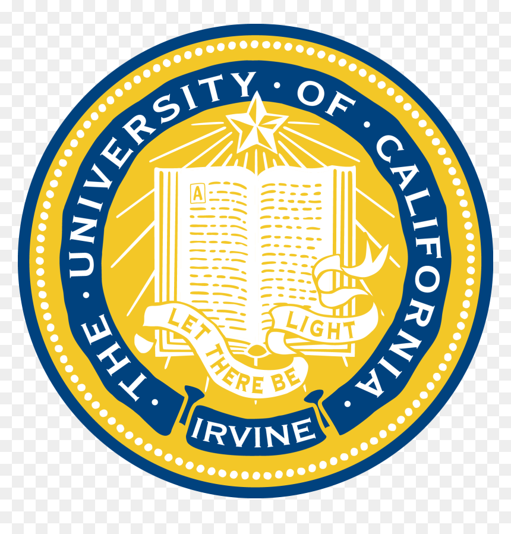

# 📖 Educations

- *2025.09 - Present*, Ph.D Candidate, EECS, **UC Irvine** . Ph.D Supervisor: [Prof. Fei Xia](https://scholar.google.com/citations?user=lQGcq6MAAAAJ&hl=en)
- *2021.09 - 2024.06*, Master, EE, **Xi'an Jiaotong Univerisity** . Master Supervisor: [Prof. Jianbin Liu](https://scholar.google.com/citations?user=DXAlCl0AAAAJ&hl=en)
- *2017.09 - 2021.06*, Bachelor, EEE, **Huazhong University of Science and Technology** 

# 💻 Experience
- *2026.06 - 2026.09*, Research Scientist Intern, **PICO-Lab, Bytedance** , San Jose, United States.
- *2024.07 - 2025.04*, Machine Learning Engineer, YLab, **OPPO Research Institute** , China. Advisor: [Prof. Lei Zhang](https://scholar.google.com/citations?user=tAK5l1IAAAAJ&hl=en)
- *2023.03 - 2023.05*, Machine Learning Intern, **VIVO Dept. of Image Effect** , China.
